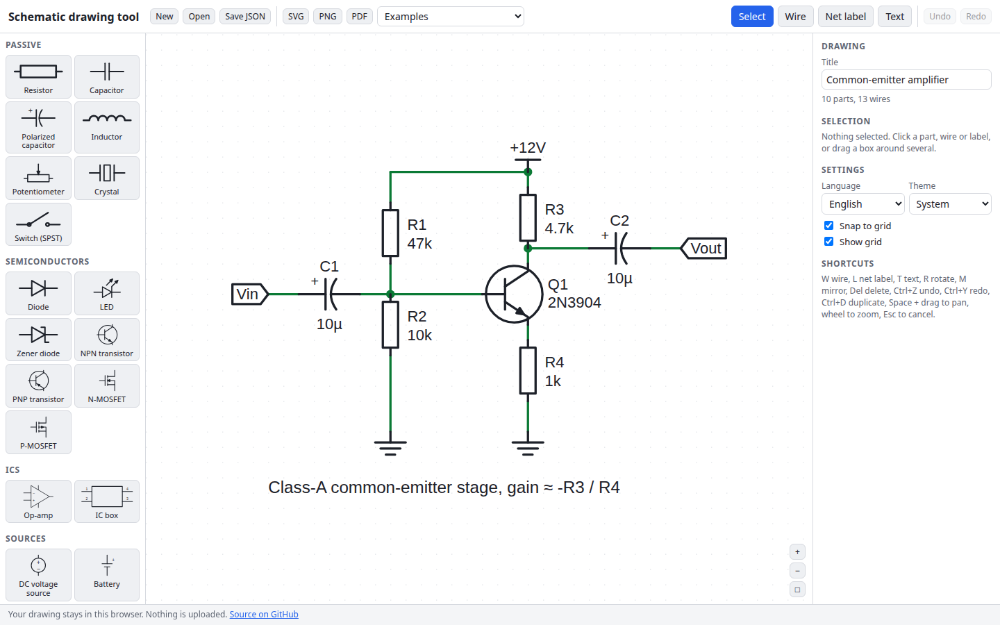

# Schematic Drawing Tool

Draw electronic circuit schematics in your browser. Pick resistors, capacitors, diodes, transistors, op-amps, ICs, sources and connectors from a symbol library, drop them on a snapping grid, connect them with wires, add net labels and text, then export clean SVG, PNG or PDF. It runs entirely client-side: your drawing never leaves the browser.

**Try it: [hermes98761234.github.io/schematic-drawing-tool](https://hermes98761234.github.io/schematic-drawing-tool/)**

[](https://github.com/hermes98761234/schematic-drawing-tool/actions/workflows/deploy.yml)



## Features

- **Symbol library.** Resistor, capacitor, polarized capacitor, inductor, potentiometer, crystal, switch, diode, LED, Zener, NPN/PNP, N/P-MOSFET, op-amp, a resizable IC box with editable pin names (DIP-style numbering), DC/AC/current sources, battery, ground, power rail and a multi-pin connector.
- **Wires that behave.** Click-click or drag to draw orthogonal wires on a grid. Wires stop at pins and other wires, junction dots appear automatically where three or more connections meet, and wires stay attached when you move, rotate or mirror a part.
- **Editing.** Select, box-select, move, rotate (R), mirror (M), duplicate (Ctrl+D), delete, net labels and free text, reference and value fields, grid snap on or off. Unlimited undo and redo.
- **Export.** SVG (black on white, independent of the theme), PNG, and a vector PDF built in the page. Save and re-open drawings as JSON. Your work is also autosaved in the browser.
- **Examples.** A common-emitter amplifier, an inverting op-amp stage, an RC low-pass, an LED with resistor and a 555 astable, all editable.
- **Comfortable anywhere.** Pan and zoom, light, dark or system theme, English and Ukrainian, responsive layout for phones and tablets.

## How it works

Everything is drawn in grid units. Each symbol is a list of simple primitives (polylines, circles, text) plus its pin positions; the same primitives feed the on-screen SVG, the SVG export and the PDF writer, so what you see is what you export. Pins always sit on integer grid points, so a wire that ends on a grid point connects. Moving, rotating or mirroring a part re-attaches the wires on its pins, inserting a corner where a wire would otherwise become diagonal. The editing logic is pure functions in `src/lib/` covered by unit tests: transforms, junction detection, wire stretching, undo history, the file format, SVG and PDF output (including the PDF cross-reference table).

Limitations: this is a drawing tool, not a simulator, so there is no netlist export or electrical rule check. PDF text uses the built-in Helvetica font, so characters outside Latin-1 (for example Cyrillic) are replaced with `?`, and the Ω sign is written as `ohm`. SVG and PNG exports keep all characters.

## Quick start

You need [Node.js](https://nodejs.org/) 22.

```bash
git clone https://github.com/hermes98761234/schematic-drawing-tool.git
cd schematic-drawing-tool
npm install
npm run dev       # http://localhost:5173
npm test          # geometry, history, file format and export tests
npm run build     # static site in dist/
```

## License

MIT
